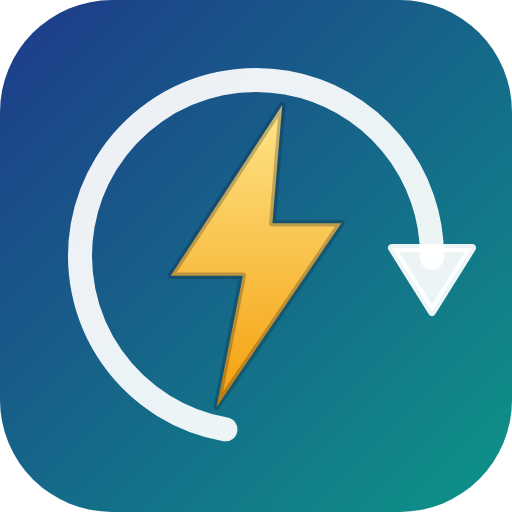

<p align="center"></p>

# UvPy Manager

🇬🇧 [English](README.md) · 🇪🇸 Español

Extensión de Azure DevOps para trabajar con Python usando [uv](https://docs.astral.sh/uv/) en tus pipelines: instala uv, descarga las versiones de Python que necesites, crea entornos virtuales y ejecuta comandos de uv. Funciona igual en agentes **Linux, Windows y macOS**, hospedados o propios.

Sin scripts distintos por sistema operativo ni pasos de instalación hechos a mano: cuatro tareas pequeñas que se encadenan.

| Tarea | Para qué |
| ----- | -------- |
| `UvSetup` | Instala uv (versión fija o `latest`) y lo agrega al PATH. Opcional: las demás tareas pueden instalarlo solas. |
| `UvPython` | Instala una o varias versiones de Python y deja una como default. |
| `UvVenv` | Crea un venv, sincroniza las dependencias y lo activa para los pasos siguientes. |
| `UvRun` | Ejecuta uno o varios comandos de uv (`sync`, `pip install`, `run`, `build`, `tool run`...). |

> **No está publicada en el Marketplace.** Es un proyecto comunitario que se distribuye como código fuente. Para usarla, empaqueta la extensión con tu propio publisher e instálala de forma privada en tu organización: ver [Instalar en tu organización](#instalar-en-tu-organización). Se ofrece tal cual, sin soporte: ver el [Descargo de responsabilidad](#descargo-de-responsabilidad).

# Instalar en tu organización

La extensión **no** está publicada en el Visual Studio Marketplace y no hay un `.vsix` compartido para descargar: una extensión de Azure DevOps va ligada a su publisher, así que la empaquetas con *tu* publisher y la instalas *de forma privada* en *tu* organización. Toma unos 10 minutos y tú controlas el código que corre en tus agentes.

1. **Crea un publisher** (gratis) en <https://marketplace.visualstudio.com/manage> y anota su ID, por ejemplo `mi-publisher`.
2. **Obtén el código**: haz fork o clona este repositorio.
3. **Genera el `.vsix`** con tu publisher (Node.js 20+):

   ```bash
   npm ci
   npm run pack -- --publisher mi-publisher
   ```

   El paquete queda en la raíz del repositorio (`mi-publisher.uvpy-manager-<versión>.vsix`) y es privado (`public: false`).
4. **Súbelo** al Marketplace, sin hacerlo público, y compártelo con tu organización. Desde el portal (*New extension → Azure DevOps → subir el `.vsix` → Share*) o con la CLI, usando un PAT con el scope **Marketplace (Manage)**:

   ```bash
   npx tfx extension publish --vsix mi-publisher.uvpy-manager-*.vsix \
     --share-with mi-organizacion --token <PAT>
   ```
5. **Instálala**: en tu organización ve a *Organization settings → Extensions → Shared* e instala *UvPy Manager*.

Para actualizar, genera de nuevo con una versión mayor y publica el nuevo `.vsix` (el mismo comando `tfx extension publish`).

**Automatízalo con un fork.** En tu fork define la variable de repositorio `EXTENSION_PUBLISHER` con el ID de tu publisher: cada push a `trunk` que cambie código crea un GitHub Release con el `.vsix` ya generado para tu publisher (ver [CI / CD](#ci--cd)).

> Al ser privada para tu organización, nadie más puede instalarla desde tu publisher y tú decides cuándo actualizar.

# Inicio rápido

```yaml
steps:
  - task: UvPython@1
    inputs:
      versions: "3.12"
  - task: UvVenv@1
    inputs:
      syncMode: project        # uv sync con el pyproject.toml / uv.lock del repo
  - task: UvRun@1
    inputs:
      commands: run pytest
```

Con eso tienes Python 3.12, un `.venv` con las dependencias del proyecto y los tests ejecutados. Si uv no está en el agente, la primera tarea lo descarga sola.

> Las tareas comparten el estado a través del job: lo que deja una (uv en el PATH, la versión de Python por defecto, el venv activo) lo usan las siguientes. Por eso van en este orden: `UvSetup` → `UvPython` → `UvVenv` → `UvRun`.

# Ejemplos de flujos reales

## 1. Proyecto con `pyproject.toml`: lint, tests y build

Un pipeline completo para una librería o aplicación gestionada con uv (`pyproject.toml` + `uv.lock`):

```yaml
trigger:
  branches:
    include: [main]

pool:
  vmImage: ubuntu-latest

steps:
  # uv fijo para que el pipeline sea reproducible
  - task: UvSetup@1
    inputs:
      version: "0.8.0"

  # Python desde el .python-version del repo (o usa `versions: "3.12"`)
  - task: UvPython@1
    inputs:
      pythonVersionFile: .python-version

  # uv sync --frozen --group dev, dentro de .venv, que queda activo
  - task: UvVenv@1
    inputs:
      syncMode: project
      syncArgs: --frozen --group dev

  - task: UvRun@1
    displayName: Lint y tests
    inputs:
      commands: |
        run ruff check .
        run ruff format --check .
        run pytest --junitxml=$(Build.ArtifactStagingDirectory)/test-results.xml

  - task: PublishTestResults@2
    condition: succeededOrFailed()
    inputs:
      testResultsFiles: $(Build.ArtifactStagingDirectory)/test-results.xml

  # Wheel y sdist en dist/
  - task: UvRun@1
    displayName: Build
    inputs:
      commands: build

  - publish: dist
    artifact: python-package
```

## 2. Probar contra varias versiones de Python y varios sistemas

Cada combinación de la matriz instala su propia versión de Python con uv; el mismo YAML sirve en los tres sistemas:

```yaml
strategy:
  matrix:
    linux_py311:   { vmImage: ubuntu-latest,  python: "3.11" }
    linux_py313:   { vmImage: ubuntu-latest,  python: "3.13" }
    windows_py312: { vmImage: windows-latest, python: "3.12" }
    macos_py312:   { vmImage: macOS-latest,   python: "3.12" }

pool:
  vmImage: $(vmImage)

steps:
  - task: UvPython@1
    inputs:
      versions: $(python)

  - task: UvVenv@1
    inputs:
      syncMode: project
      syncArgs: --frozen

  - task: UvRun@1
    inputs:
      commands: run pytest
```

## 3. Proyecto con `requirements.txt` (sin pyproject)

```yaml
steps:
  - task: UvPython@1
    inputs:
      versions: "3.12"

  - task: UvVenv@1
    inputs:
      syncMode: requirements
      requirementsFile: requirements.txt
      syncArgs: --index-url https://mi-feed/simple   # opcional

  # `python` ya es el del venv en los pasos siguientes
  - script: python manage.py test
    displayName: Tests
```

## 4. Herramientas puntuales sin venv (`uv tool run`)

Para ejecutar una herramienta suelta (linters, formateadores, `pre-commit`...) no hace falta crear un entorno:

```yaml
steps:
  - task: UvRun@1
    inputs:
      commands: |
        tool run ruff check .
        tool run --from "mypy>=1.10" mypy src
```

## 5. Caché de uv entre ejecuciones

Guardar la caché de uv acelera las instalaciones. Se activa con la tarea `Cache@2` y la variable `UV_CACHE_DIR`:

```yaml
variables:
  UV_CACHE_DIR: $(Pipeline.Workspace)/.uv-cache

steps:
  - task: Cache@2
    inputs:
      key: 'uv | "$(Agent.OS)" | uv.lock'
      restoreKeys: |
        uv | "$(Agent.OS)"
      path: $(UV_CACHE_DIR)

  - task: UvVenv@1
    inputs:
      syncMode: project
      syncArgs: --frozen
```

## 6. Usar los outputs de una tarea

Pon un `name` al paso y léelo como `$(nombre.output)`:

```yaml
steps:
  - task: UvPython@1
    name: py
    inputs:
      versions: "3.12"

  - task: UvVenv@1
    name: venv
    inputs:
      syncMode: project

  - script: |
      echo "Python: $(py.pythonVersion) en $(py.pythonPath)"
      echo "Venv:   $(venv.venvPath)"
```

# Salida enriquecida

Cada tarea deja un log fácil de leer y un resumen en la ejecución, sin configurar nada:

- **Grupos plegables** en el log (`uv sync`, instalación de Python...), con una tabla final al terminar.
- **Resumen en markdown** en la pestaña **Extensions** de la ejecución: versión de uv, versiones de Python instaladas, venv creado y, en `UvRun`, cada comando con su estado (✔ / ✖) y su duración.
- **Avisos y errores** como anotaciones de la ejecución: si un comando falla con `failOnError: false`, la tarea termina con avisos y los fallos se listan.

Ejemplo del final del log de `UvRun`:

```
##[section]UvRun summary
   Command                  Exit  Time
-  -----------------------  ----  ----
✔  uv sync --frozen         0     1.2s
✔  uv run pytest            0     8.4s
✖  uv run ruff check .      1     310ms
```

Para ver los mensajes internos de las tareas, ejecuta el pipeline con `system.debug: true`.

# Referencia de las tareas

Los inputs y outputs completos están en el `task.json` de cada tarea (`src/tasks/<tarea>/task.json`) y en el editor de pipelines.

## UvSetup

| Input | Por defecto | Descripción |
| ----- | ----------- | ----------- |
| `version` | `latest` | `latest` o una versión exacta (`0.8.0`). Fíjala para builds reproducibles. |
| `addToPath` | `true` | Deja `uv` disponible en los pasos siguientes. |
| `verifyChecksum` | `true` | Verifica el sha256 publicado del binario descargado. |
| `downloadBaseUrl` | | Mirror de los releases de uv, para agentes sin internet. |

Outputs: `uvPath`, `uvVersion`, `uvCacheHit` (`true` si salió del tool cache del agente).

## UvPython

**Qué versión instala** (por prioridad):

1. `versions` (una por línea o separadas por coma): `3.13`, `3.12.4`, `pypy@3.10`, `>=3.11`...
2. Si está vacío, el archivo `pythonVersionFile` (por defecto `.python-version`; también acepta `.tool-versions`).
3. Si no hay ninguna, la tarea falla con un mensaje claro.

| Input | Por defecto | Descripción |
| ----- | ----------- | ----------- |
| `versions` | | Versiones a instalar. |
| `pythonVersionFile` | `.python-version` | Se usa solo si `versions` está vacío. |
| `setDefault` | `true` | La primera versión queda como default: `python` y `python3` la usan en los pasos siguientes (`UV_PYTHON` + PATH). |
| `writePythonVersionFile` | `false` | Crea `.python-version` con `uv python pin` (solo si las versiones vienen del input). |
| `pythonPreference` | `managed` | `managed`, `only-managed`, `system` u `only-system` (con esta última no se descarga nada). |
| `pythonInstallMirror` | | Mirror de python-build-standalone, para agentes sin internet. |
| `workingDirectory` | directorio por defecto | Dónde corre uv. |

Outputs: `pythonPath`, `pythonVersion` y `pythonInstalledVersions` (JSON con `request`, `path`, `version`, `managed`).

## UvVenv

| Input | Por defecto | Descripción |
| ----- | ----------- | ----------- |
| `venvPath` | `.venv` | Ruta del venv, relativa al directorio de trabajo. Si existe se reutiliza. |
| `pythonVersion` | | Versión de Python del venv. Vacío = la default de `UvPython`, `.python-version` o la que encuentre uv. |
| `clear` | `false` | Recrea el venv si ya existe (`uv venv --clear`). |
| `syncMode` | `none` | `none`, `project` (`uv sync`) o `requirements` (`uv pip install -r`). |
| `requirementsFile` | `requirements.txt` | Se usa con `syncMode: requirements`. |
| `syncArgs` | | Argumentos extra para `uv sync` / `uv pip install` (`--frozen`, `--group dev`, `--index-url ...`). |
| `activate` | `true` | Los pasos siguientes usan el venv: `VIRTUAL_ENV`, `UV_PROJECT_ENVIRONMENT` y su `bin`/`Scripts` al inicio del PATH. |

Outputs: `venvPath` y `venvPython`.

## UvRun

Un comando por línea, sin el `uv` inicial (si lo pones, se ignora). `#` abre un comentario y las comillas agrupan argumentos. Se ejecuta sin shell, así que se comporta igual en Linux, Windows y macOS.

```yaml
- task: UvRun@1
  inputs:
    commands: |
      sync --frozen
      pip install "ruff>=0.5"
      run pytest
    env: |
      UV_INDEX_URL=https://mi-feed/simple
    failOnError: true
```

| Input | Por defecto | Descripción |
| ----- | ----------- | ----------- |
| `commands` | `sync --frozen` | Comandos de uv, uno por línea. |
| `env` | | Variables `CLAVE=VALOR`, una por línea (`UV_INDEX_URL`, `UV_CACHE_DIR`...). |
| `failOnError` | `true` | Se detiene en el primer comando que falla. Con `false` corren todos y la tarea termina con avisos si alguno falló. |

Output: `exitCode` (0, o el del primer comando que falló).

## Inputs comunes

`UvPython`, `UvVenv` y `UvRun` aceptan además:

| Input | Por defecto | Descripción |
| ----- | ----------- | ----------- |
| `workingDirectory` | directorio por defecto del job | Dónde se ejecuta uv. |
| `autoInstallUv` | `true` | Si uv no está en el agente, lo descarga (misma lógica que `UvSetup`). Desactívalo en agentes restringidos y usa `UvSetup` o un uv preinstalado. |
| `uvVersion` | `latest` | Versión de uv a descargar si hace falta instalarlo. |

# Descargo de responsabilidad

- Es un proyecto personal y comunitario bajo la [licencia MIT](LICENSE): se ofrece **«tal cual», sin garantía de ningún tipo**, y el autor no se hace responsable de daños, pérdida de datos o costes derivados de su uso.
- **No está publicada en el Marketplace**, **no tiene soporte ni SLA** y no está afiliada ni respaldada por Microsoft, Azure DevOps ni Astral (uv). Los issues y pull requests son bienvenidos, pero se atienden en la medida de lo posible.
- Las tareas descargan y ejecutan binarios de terceros en tus agentes (uv y los Python que instala; la descarga de uv se verifica con checksum por defecto). **Revisa el código, fija versiones** (`UvSetup` con una `version` exacta) **y pruébala en un pipeline que no sea de producción** antes de depender de ella.
- Tú eres responsable de empaquetar, publicar y operar tu propia copia de la extensión.

---

# Desarrollo

```bash
npm install                 # instala la raíz y cada tarea (azde-scripts)
npm test                    # jest: src/shared + cada tarea
npm run typecheck           # tsc sobre shared y cada tarea
npm run pack:dev            # paquete privado de desarrollo (config/dev.json)
npm run pack                # paquete de release (config/release.json)
```

Estructura:

```
src/shared/        código común (detección de plataforma, ensureUv, runUv, inputs)
src/tasks/<tarea>/ una carpeta por tarea (task.json, src/, tests)
docs/DESIGN.md     decisiones de diseño y fases
```

## CI / CD

| Dónde | Archivo | Qué hace |
| ----- | ------- | -------- |
| GitHub Actions | `.github/workflows/ci.yml` | Tests y typecheck en Linux, Windows y macOS; empaqueta un `.vsix` de desarrollo (artifact `vsix-dev`). |
| GitHub Actions | `.github/workflows/release.yml` | En cada push a `trunk` que toque código (`src/` sin tests, `vss-extension.json`, `config/release.json`, `images/`, `package*.json`, `tsconfig.json`) calcula la siguiente versión (patch sobre el último tag), crea el tag `vX.Y.Z` y el GitHub Release y adjunta el `.vsix` generado para el publisher de la variable de repositorio `EXTENSION_PUBLISHER` (por defecto `hendamm`, el del mantenedor). No se dispara con cambios en README, docs, tests, workflows ni pipelines. También se puede lanzar a mano eligiendo `patch`/`minor`/`major`. |
| Azure Pipelines | `azure-pipelines.yml` | Empaqueta las tareas y las valida en agentes reales Linux, Windows y macOS: instala uv, Python, crea un venv y ejecuta comandos. |

Para publicar basta con mergear a `trunk`: la versión de la extensión y la de cada `task.json` se fijan automáticamente en el release. Para subir minor o major, lanza el workflow a mano.

La validación de Azure ejecuta los bundles con `scripts/run-task.js` (el agente interpreta los comandos `##vso` que imprimen) y comprueba el resultado con `scripts/expect.js`. También sirve en local tras `npm run package:tasks`:

```bash
node scripts/run-task.js uv-setup version=0.8.0
node scripts/run-task.js uv-run "commands=pip list\nrun python --version"   # \n = salto de línea
```

Ejecutar una tarea en local: copia `src/tasks/<tarea>/.env-test` a `.env`, complétalo y corre `npm run test-local` dentro de la tarea.
